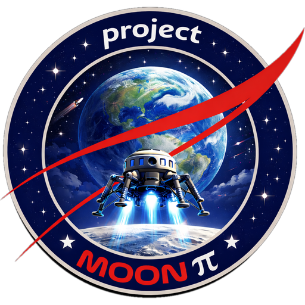
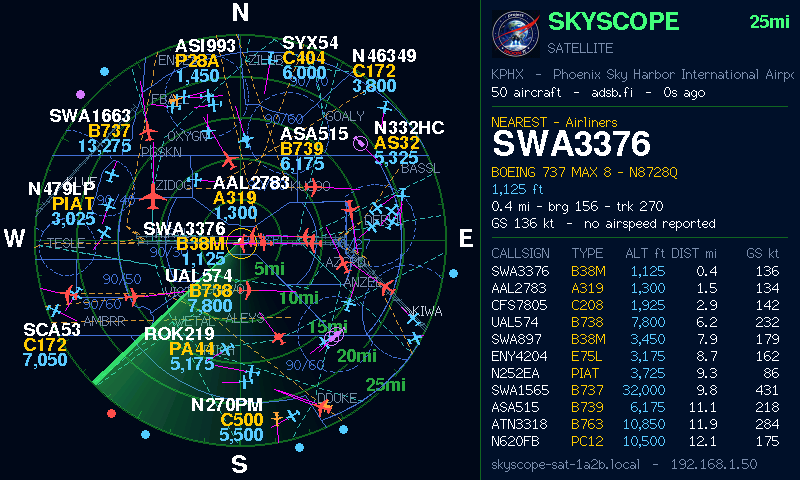

<p align="center"></p>

# SkyScope Satellite

**A 4.3″ display that mirrors your [SkyScope](https://github.com/ricsne2010/skyscope) radar.**
A Project Moon Pi project.

SkyScope does the work on a Raspberry Pi (data, filters, map); the Satellite
asks it for the picture once a second over Wi-Fi and draws it, moving the
aircraft smoothly in between. Change the range, filters or map on SkyScope's
settings page and every Satellite follows.



> **Early release.** 1.1.1 builds cleanly and its screen has been checked with
> the same drawing code running on a computer (the picture above), but it has not
> yet been run on the board itself. Please [open an issue](https://github.com/ricsne2010/skyscope-satellite/issues)
> if something doesn't work.

## Documentation

- **[SkyScope Satellite Guide (PDF)](docs/SkyScope-Satellite-Guide.pdf)**: installing, Wi-Fi setup, connecting, troubleshooting.
- The same guide as a web page: [docs/guide.html](docs/guide.html).

## What you need

| Item | Details |
|---|---|
| Display | **Sunton ESP32-8048S043**: ESP32-S3 (16 MB flash, 8 MB PSRAM), 4.3″ 800×480, GT911 capacitive touch |
| Cable and power | USB-C data cable; any 5 V USB supply of 1 A or more |
| Network | 2.4 GHz Wi-Fi |
| SkyScope | [SkyScope](https://github.com/ricsne2010/skyscope) 1.1 or later on the same network, settings page on (port 7700) |
| Case (optional) | A 3D-printable radar-console desk case: [case/](case) |

## Install

**From a browser (no tools needed):** download `skyscope-satellite-1.1.1.bin` from
the [latest release](https://github.com/ricsne2010/skyscope-satellite/releases/latest),
open the [ESP web flasher](https://espressif.github.io/esptool-js/) in Chrome or
Edge, connect to the board, and program the file at address **0x0**. If no port
shows up, hold **BOOT**, tap **RST**, release BOOT and connect again.

**From source with [PlatformIO](https://platformio.org):**

```sh
git clone https://github.com/ricsne2010/skyscope-satellite.git
cd skyscope-satellite
pio run -t upload
```

## First start

1. Join the Wi-Fi network **SkyScope-Satellite-Setup** from a phone; the setup page opens.
2. Choose your network and enter its password. Leave the SkyScope address as
   `skyscope.local`, or enter the **Satellite address** from the **About** tab of
   SkyScope's settings page.
3. Save. The Satellite connects and shows your radar.

The easiest pairing is to name the Pi `skyscope` (`sudo raspi-config` →
System Options → Hostname). Each Satellite has a small web page at the address
shown at the bottom right of its screen (`http://skyscope-sat-xxxx.local`) for
changing the SkyScope address. Hold **BOOT** for 3 seconds to set up Wi-Fi again.

## Display hardware (pins)

Board revisions differ. If the screen is blank, shifted or the wrong colours,
or touch doesn't respond, set the wiring on the **Display hardware** page
(`http://skyscope-sat-xxxx.local/hardware`) without rebuilding anything:

- the 16 RGB data lines, DE/VSYNC/HSYNC/PCLK and the backlight pin
- pixel clock, porches, sync polarities
- touch chip (GT911 or none), its pins and address

With a blank screen, hold **BOOT 3 s** and let go to start Wi-Fi setup, join
**SkyScope-Satellite-Setup**, and press **Display hardware** there. Pins are checked before saving
(GPIO 1–21 or 38–48, no duplicates). **Hold BOOT 10 s**, or press *Restore
defaults*, to go back to the ESP32-8048S043 wiring.

## How it works

SkyScope serves `/api/satellite` (traffic, status, card and list, positions in
ring units with velocities) and `/api/satellite/map` (runways, airspace and
procedure lines clipped to the scope, fetched only when they change). The
Satellite does no geography: it scales, moves and draws.

| File | Does |
|---|---|
| `src/feed.cpp` | Finds SkyScope (mDNS) and polls it on its own task, double-buffered |
| `src/feed_parse.cpp` | Reads the JSON into fixed-size structures (no heap churn over days) |
| `src/render.cpp` | Draws the screen: static layer, sweep, aircraft, labels, panel |
| `src/scope.cpp` | Scope drawing shared with SkyScope Mini |
| `src/device.cpp` | Splash, Wi-Fi setup, BOOT button, mDNS |
| `include/board.h`, `board_pins.h` | The display driver and its default wiring |
| `src/hardware.cpp` | The Display hardware page; the wiring saved in flash |
| `include/shapes.h` | Aircraft silhouettes, generated from SkyScope by `tools/gen_shapes.py` |
| `tools/preview/` | Builds the drawing code on a computer and renders a frame to an image |

## Credits and licence

MIT licence (see [LICENSE](LICENSE)). Libraries: LovyanGFX (FreeBSD),
WiFiManager (MIT), ArduinoJson (MIT). The Project Moon Pi name and logo are not
covered by the licence. Not for navigation.
