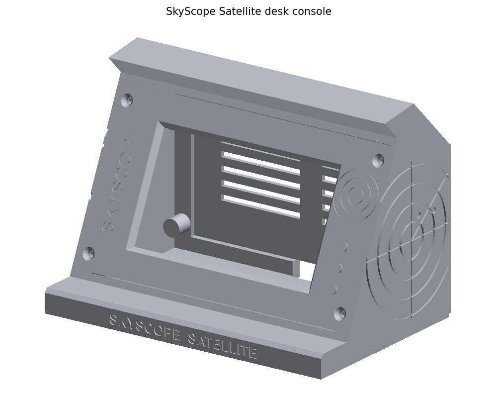
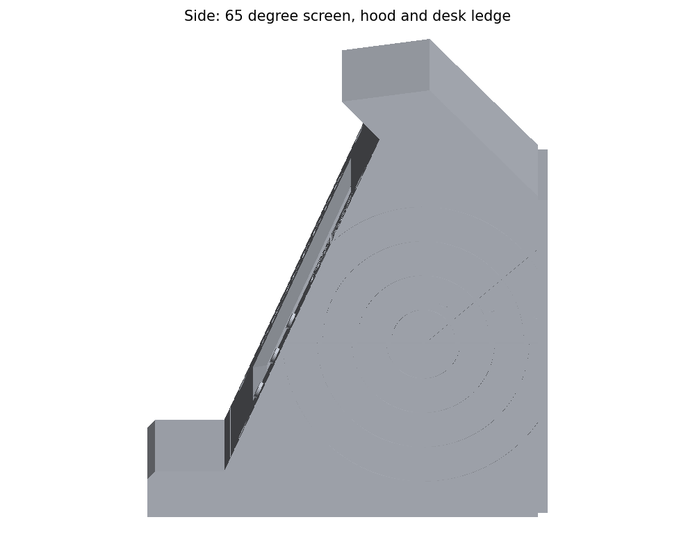
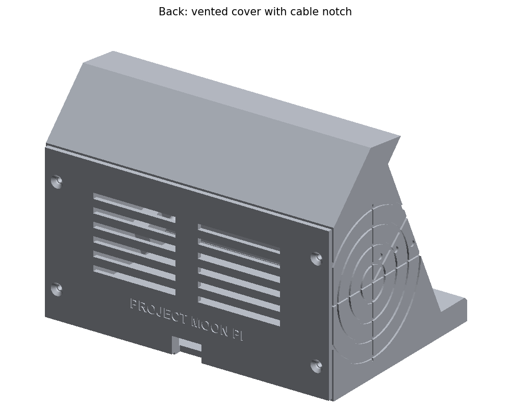
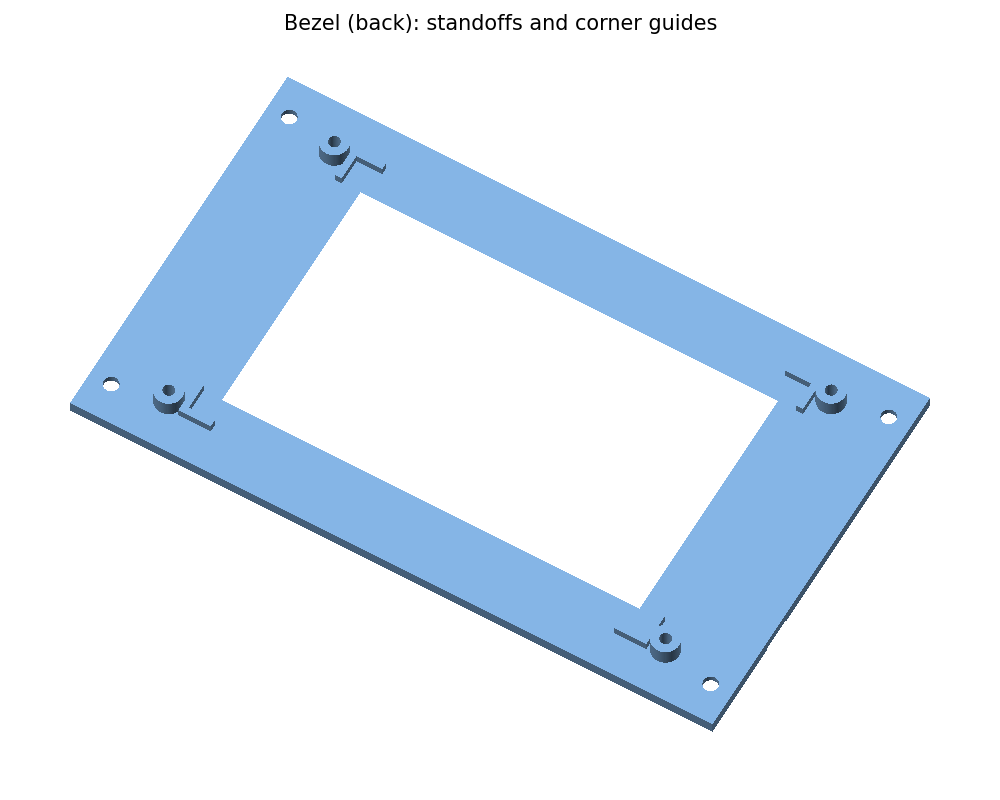
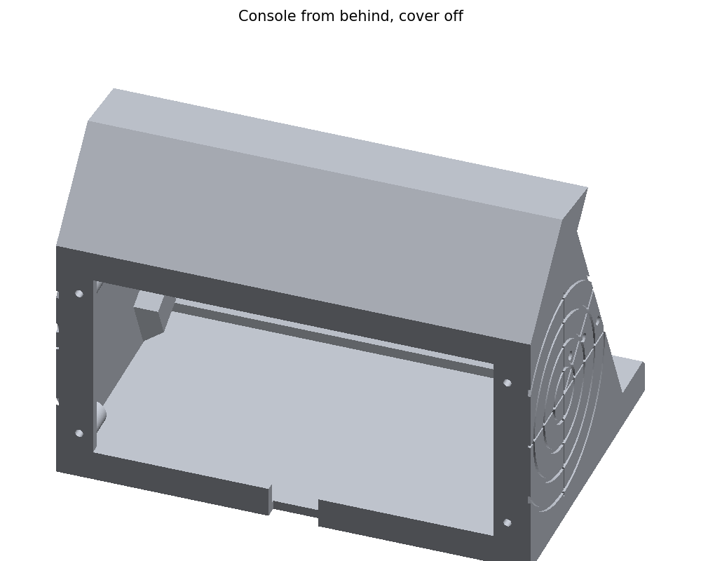

# SkyScope Satellite desk console (3D-printed case)

A case for the Sunton ESP32-8048S043 display in the style of an air-traffic
radar console: the screen tilted back to 65° under a hood, a desk ledge in
front, radar rings on the sides. It fits **SkyScope Mini** too (same board);
set `LEDGE_TEXT` to `"SKYSCOPE  MINI"` and regenerate.



| | |
|---|---|
|  |  |
|  |  |

Outside size: 154 mm wide, 102 mm deep, 112 mm tall.

## Before you print: measure your board

The board's makers publish no mechanical drawing, so some sizes in
[`make_case.py`](make_case.py) are best estimates (marked `check`). With
calipers, measure and compare:

| Setting | What to measure | Default |
|---|---|---|
| `PCB_W`, `PCB_H` | Circuit board outline | 123 × 74 mm |
| `LCD_W`, `LCD_H` | Display glass outline | 105.5 × 67.2 mm |
| `LCD_OFF_X`, `LCD_OFF_Y` | How far the glass's centre is from the board's centre (right and up, looking at the screen) | 0, 0 |
| `LCD_T` | Front of the glass to the front of the board | 4.2 mm |
| `HOLE_DX`, `HOLE_DY` | Board centre to a mounting hole's centre | 58.0, 33.5 mm |

Then, in the `skyscope-satellite` folder, regenerate (about 15 seconds) with FreeCAD 1.0 or newer:

```sh
/Applications/FreeCAD.app/Contents/Resources/bin/freecadcmd -c "exec(open('case/make_case.py').read())"
/Applications/FreeCAD.app/Contents/Resources/bin/python case/render_preview.py   # optional: new pictures
```

(On Windows or Linux, use the `freecadcmd` and `python` that come with
FreeCAD.) **Print `fit-test.stl` first** (about 20 minutes): a 2 mm slice of
the bezel with its standoffs and corner guides. The board should screw on and
the glass sit square in the guides.

## Parts and printing

All in [`stl/`](stl) (and editable STEP files in [`step/`](step)), already
in their print orientation:

| File | Prints | Notes |
|---|---|---|
| `console.stl` | Upright, on its base | No supports needed: the hood and screw pads are 45° underneath |
| `bezel.stl` | Face down | The engraving and window bevel come out cleanest on the bed |
| `back-cover.stl` | Outside face down | |
| `fit-test.stl` | Face down | Optional, but saves a failed print |

PLA or PETG, 0.2 mm layers, 3 walls, 15–20% infill. A dark grey or black
console with a contrasting bezel looks the part.

## Hardware

| Qty | Part | For |
|---|---|---|
| 4 | M3 × 6 pan-head screws | Board to the bezel's standoffs |
| 4 | M3 × 8 countersunk screws | Bezel to the console (visible panel screws) |
| 4 | M3 × 8 countersunk screws | Back cover |
| 4 | Small rubber feet | Optional, under the console |

The screw holes are sized for self-tapping into plastic (2.6 mm). For
heat-set inserts instead, set `PILOT = 4.0` and regenerate.

## Assembly

1. Screw the board to the back of the bezel (glass against the bezel, into
   the corner guides). If the glass rattles, a strip of foam tape takes up
   the gap; if the board won't reach the standoffs, `LCD_T` is too small.
2. Plug in the USB-C cable. A right-angle plug fits best; there's 12 mm of
   room beside the board.
3. Lower the bezel and board into the console's front recess and fit the four
   countersunk screws.
4. Route the cable out of the notch at the bottom of the back, and screw on
   the back cover.

To reach the BOOT button (Wi-Fi reset, display wiring reset), take off the
back cover.
